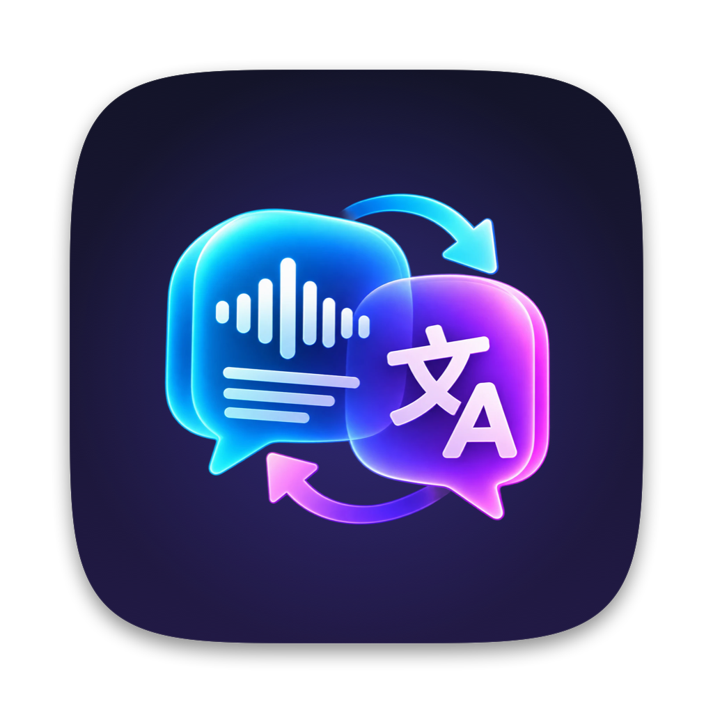
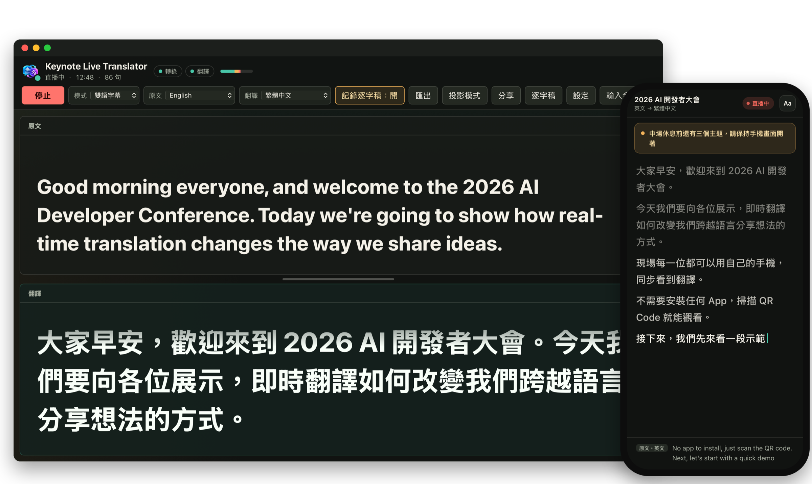
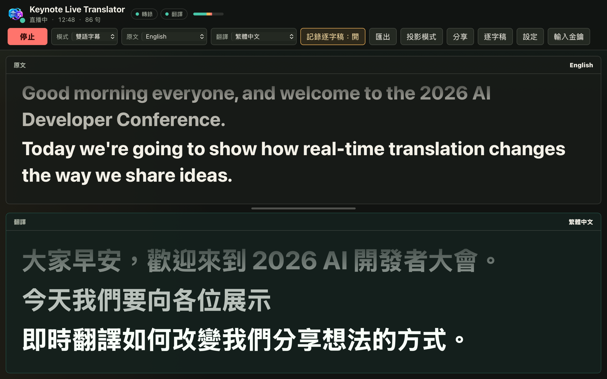
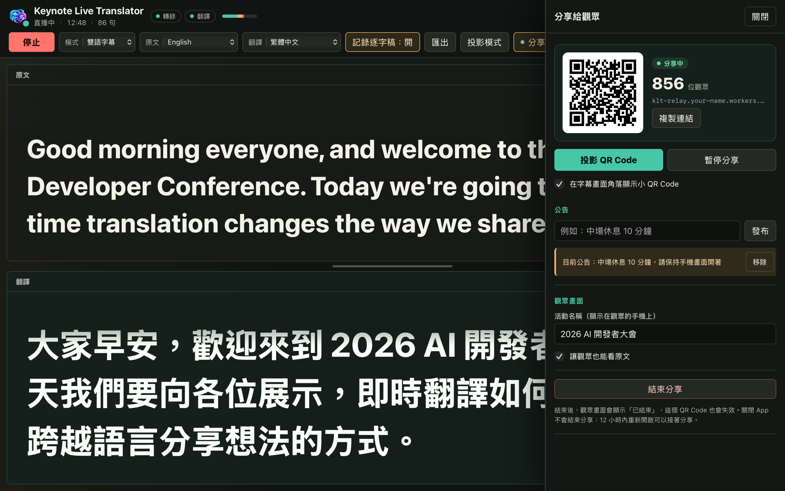
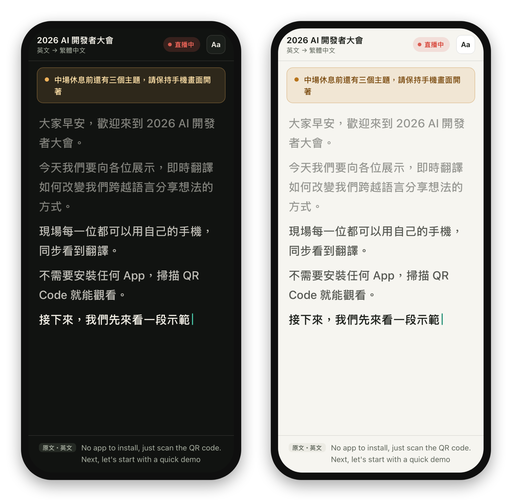
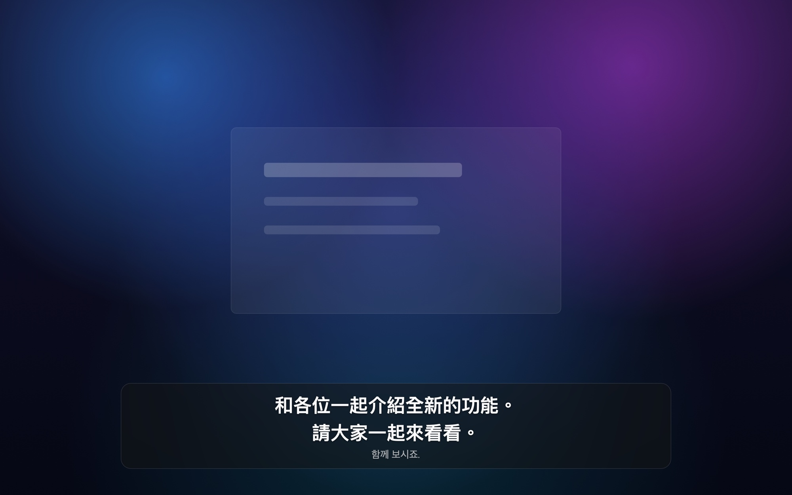
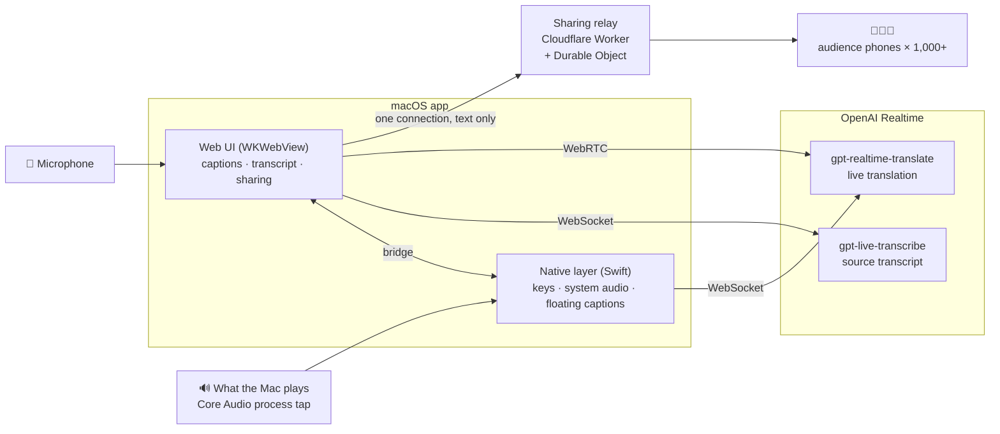
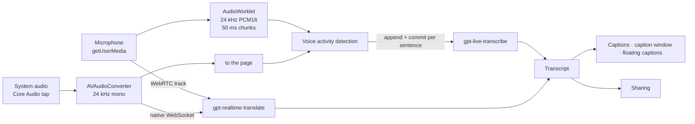
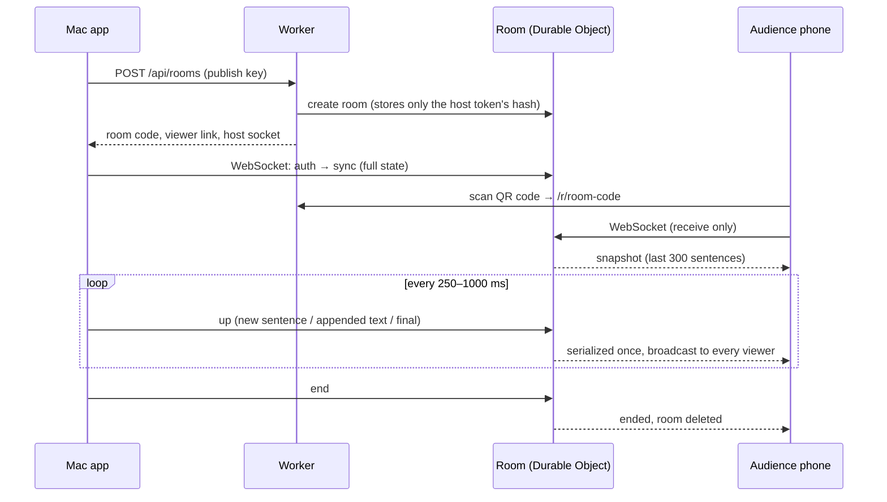

<p align="center">
  
</p>

<h1 align="center">Keynote Live Translator</h1>

<p align="center">
  <strong>Live captions and translation for talks, meetings and videos — and the whole audience can follow along on their own phones.</strong><br />
  A native macOS app built on OpenAI <code>gpt-live-transcribe</code> and <code>gpt-realtime-translate</code>.
</p>

<p align="center">
  <a href="https://github.com/polarbear0827/Keynote-Live-Translator/releases/latest"></a>
  <a href="https://github.com/polarbear0827/Keynote-Live-Translator/actions/workflows/ci.yml"></a>
  
  
</p>

<p align="center"><a href="README.md">繁體中文</a> ｜ <strong>English</strong></p>

<p align="center">
  
</p>

> The app's interface is in Traditional Chinese, so the screenshots are too. Captions and translations
> work with 13 spoken languages and 13 target languages, including English.

---

## Contents

- [Why use it](#why-use-it)
- [Feature tour](#feature-tour)
- [Quick start](#quick-start)
- [Sharing with the audience](#sharing-with-the-audience)
- [Architecture](#architecture)
- [Performance and capacity](#performance-and-capacity)
- [Security and privacy](#security-and-privacy)
- [Quality assurance](#quality-assurance)
- [Development](#development)
- [Troubleshooting](#troubleshooting)

## Why use it

| | |
|---|---|
| 🎯 **Made for the stage** | Large captions, bilingual layout, presentation mode, a second-screen caption window, chroma-key green background, and a level check before you go live. |
| 📱 **The whole room reads along** | People scan a QR code and read the live translation on their phones — nothing to install. Measured with 1,000 simulated viewers: 95% of captions arrived within 0.35 s. |
| 💸 **More viewers, same cost** | Translation runs once, on the speaker's Mac; only text is shared. The sharing relay fits in Cloudflare's free plan. |
| 🎧 **Translate videos without speakers** | Captures what the Mac is playing (YouTube, online meetings) digitally — headphones are fine — and floats the translation over full-screen video. |
| 🔐 **Your key stays on your Mac** | The OpenAI key lives only in the app (optionally in the macOS Keychain); the web page never sees it. The sharing relay is yours too. |
| 🧠 **Two specialised models** | `gpt-live-transcribe` for an accurate source transcript (with keywords and context), `gpt-realtime-translate` for translation. |
| 🛟 **Built for long sessions** | Automatic reconnection, a seamless switch before the 60-minute session limit, the last sentence finished on stop, transcript auto-backup. |
| 📝 **Subtitles ready after the talk** | Export SRT (source / translation / bilingual), Markdown, plain text or JSON; SRT cues follow subtitle conventions. |
| 🪶 **Small and native** | A universal Swift + WKWebView app of about 4 MB — no Electron, no background services. |

## Feature tour

### Live bilingual captions

Source and translation stacked, **one phrase per line**: when the speaker finishes a sentence or the translation pauses, the caption moves to a new line — the newest line stands out and older ones fade, like film subtitles. Switch between bilingual, translation only and source only. 13 source and 13 target languages; Chinese is converted to Taiwan Traditional Chinese with OpenCC.

<p align="center"></p>

### Presentation mode and caption window

Press <kbd>F</kbd> for full-screen presentation mode, or open the caption window on a second screen (a projector) while you keep the controls. Light, dark, black or chroma-key green backgrounds; caption size and the split between source and translation adjust live.

<p align="center"></p>

### Sharing with the audience

Start sharing and everyone in the room scans a QR code to read the live translation on their own phone. You see how many people are watching, can pause sharing (nothing said while paused is ever sent), push announcements, and end the share — the link stops working.

<p align="center"></p>

One click (or <kbd>Q</kbd>) projects a full-screen QR code — on the caption window too, if it's open:

<p align="center"></p>

What the audience sees: large text, the newest sentence highlighted, optional original text, dark/light and text size settings, the screen kept awake, and automatic reconnection that catches up on anything missed:

<p align="center"></p>

### Translating what your Mac plays (floating captions)

Choose the audio source "電腦播放的聲音" (what the Mac is playing): the app captures the audio digitally with Core Audio — nothing has to play through the speakers — and shows the translation in a frosted, always-on-top floating window that stays visible over full-screen video — also one phrase per line. Resize it freely (the text grows with it), change its transparency, or lock it so clicks pass through.

<p align="center"></p>

### Transcript and export

- The transcript panel records source and translation live, with translation-delay compensation and a timeline that continues across Start/Stop.
- Export **bilingual / translation / source SRT**, **Markdown**, **plain text** and **JSON**. SRT cues are at most 7 seconds and two lines, CJK punctuation never starts a line, and the whole file can be shifted in time.
- Auto-backup on the device, offered for restore after an unexpected quit.

## Quick start

1. Download `KeynoteLiveTranslator-<version>.pkg` from [Releases](https://github.com/polarbear0827/Keynote-Live-Translator/releases/latest) and install it (macOS 12.3 or later; capturing what the Mac plays needs macOS 14.2 or later).
2. Open the app and enter your OpenAI API key. It's verified right away, including access to both models; it's stored in the macOS Keychain only if you tick "記住金鑰" (remember key).
3. Pick the mode and languages, and check the input level in 設定 > 收音 > 測試麥克風 (Settings > Audio > Test microphone). Add **keywords** (speaker and product names, jargon) and a one-line **context** to improve accuracy.
4. Press 開始 (Start), or Space.

> **macOS blocks the app?** If the release isn't notarized yet: Finder → Applications → right-click Keynote Live Translator → Open.

### Keyboard shortcuts

| Key | Action | Key | Action |
|---|---|---|---|
| <kbd>Space</kbd> | Start / stop | <kbd>T</kbd> | Transcript panel |
| <kbd>P</kbd> | Pause / resume caption display | <kbd>Q</kbd> | Project the sharing QR code |
| <kbd>M</kbd> | New paragraph | <kbd>+</kbd> / <kbd>−</kbd> | Larger / smaller captions |
| <kbd>F</kbd> | Presentation mode | <kbd>Esc</kbd> | Close panels, leave presentation mode |
| <kbd>⌘</kbd><kbd>⇧</kbd><kbd>O</kbd> | Floating captions | <kbd>⌘</kbd><kbd>⇧</kbd><kbd>L</kbd> | Lock floating captions |

## Sharing with the audience

### One-time setup (about 5 minutes)

Sharing runs on your own relay (a Cloudflare Worker; the free plan is enough). You only do this once:

1. Create a free [Cloudflare account](https://dash.cloudflare.com/sign-up).
2. In this repository, run:

   ```bash
   npm run relay:deploy
   ```

   The first time, a browser window asks you to log in to Cloudflare and allow access; Cloudflare may ask you to pick a `workers.dev` name.
3. When the relay is up, the app asks "**連接分享伺服器？**" (connect to the sharing relay?) — press **連接** (Connect). Nothing to copy.

> The relay's address is printed in every QR code, so a "publish key" makes sure only your app can open rooms on it. The deploy script generates it (kept in `relay/.publish-key`, never committed) and hands it to the app through a `keynote-live-translator://` link; the app stores it in the Keychain and always asks before connecting. After reinstalling or on another Mac, run `npm run relay:connect`.

### On the day

1. **分享 → 開始分享** (Share → Start sharing). Optionally set the event name shown on phones and whether viewers may see the original. You can start before the talk; phones show "waiting for the speaker".
2. **投影 QR Code** (<kbd>Q</kbd>) to project the QR code, or keep a small one in the corner of the captions.
3. **暫停分享** (pause) for off-the-record parts; **公告** (announcement) pushes a line of text to every phone, for example a break.
4. **結束分享** (end sharing) when done: phones show "ended" and the link stops working. Quitting the app doesn't end the share; reopen it within 12 hours to continue the same room, without anyone rescanning.

## Architecture



### Two hosts, one UI

| Host | UI served by | API key and OpenAI calls | Local port |
|---|---|---|---|
| macOS app | Swift static server (`127.0.0.1`, static files only) | Native Swift, via `WKScriptMessageHandlerWithReply` | Static files only, Host-checked |
| Browser (`npm start`) | Node dev server | Node, behind a per-launch token | Host / Origin / token-checked |

Both backends implement the same rules from [`public/realtime-config.json`](public/realtime-config.json) (models, languages, limits). `tests/contract.test.mjs` compiles the Swift version and checks that both produce identical OpenAI requests and validation errors.

### Audio pipeline



- **Source**: `gpt-live-transcribe` runs as a Realtime transcription session over WebSocket. It has no server-side VAD, so a client-side VAD commits each sentence when the speaker pauses; long turns are cut at a pause after 15 seconds. Supports `languages`, `delay` (five steps from fastest to most accurate), `keywords` and `prompt`.
- **Translation**: `gpt-realtime-translate` detects the spoken language and outputs the chosen language (it can also play translated speech). The microphone goes over WebRTC with a short-lived client secret; system audio is already inside the app, so it goes over the app's own WebSocket and avoids networks that block UDP.
- **Resilience**: each connection reconnects on its own with exponential backoff. Realtime sessions end after 60 minutes, so at 55 minutes a new connection is set up and audio switches over seamlessly; Stop sends `session.close` and waits for the last sentence.

### Captions and transcript

- Source and translation are separate timed tracks; SRT export aligns them by overlap, so translation lag never shifts the source.
- **One phrase per line**: streamed text starts a new line at a *confirmed* sentence end (`3.` may still become `3.14`), when the translation pauses for 0.9 s or more (the model's Chinese often has no punctuation, so pauses are the most reliable phrase boundary), or at a comma when a phrase runs long. The main window, caption window, floating captions and audience phones all use the same lines.
- Simplified → Traditional conversion (OpenCC `cn → twp`) runs on whole passages at display/export time, never on single deltas, so words split across deltas (头 + 发 → 頭髮) still convert correctly.
- Rendering is batched to one update per animation frame; the floating captions run on a timer, so they keep updating while the main window is hidden behind full-screen video.

### macOS native layer

- Swift AppKit + WKWebView, compiled with `swiftc` into an arm64 + x86_64 universal binary and packaged with `pkgbuild` — about 4 MB.
- The page is served by a local static server written with `Network.framework` (`127.0.0.1`; other Host headers are rejected against DNS rebinding). The OpenAI key exists only on the native side.
- System audio: a process tap and aggregate device (`CATapDescription`, `AudioHardwareCreateProcessTap`), rebuilt automatically when the output device changes.
- Floating captions: a non-activating `NSPanel` (status-bar level, on all Spaces, full-screen auxiliary). The font size is derived from the window height; whole sentences are laid out and the oldest dropped first.

### Sharing relay (`relay/`)



- **One Durable Object per room**, using the WebSocket Hibernation API: an idle room can sleep without accruing duration, and viewers' pings are answered by Cloudflare without waking it.
- **Incremental protocol**: each caption sentence is an entry changed by four operations — add, append text, mark final, delete; most updates append a few characters. A room keeps only the last 300 sentences in memory and asks the app to resync after an eviction.
- **Update rate follows the audience**: 4 updates per second up to 400 viewers, 2 up to 1,500, then 1 (see [Performance and capacity](#performance-and-capacity)).
- **The viewer page** is a static page (no framework, no tracking) with Wake Lock, jittered reconnection, dark/light and text-size settings.
- **QR codes** come from a built-in encoder (no third-party package); the tests decode them with Apple's Vision framework.

## Performance and capacity

Measured on Cloudflare with simulated viewers (all connecting from one Mac, about 0.2 s baseline round trip):

| Concurrent viewers | Update rate | Delivered | 95th percentile delay | 99th percentile delay |
|---:|---:|---:|---:|---:|
| 200 | 4 per second | 100% | 0.49 s | 0.74 s |
| **1,000** | **2 per second (automatic)** | **100%** | **0.35 s** | **0.37 s** |
| 1,500 | 1 per second | 100% | 0.85 s | 1.24 s |
| 2,000 | 1 per second | 100% | 1.32 s | 2.37 s |

Locally (`wrangler dev`), 2,000 viewers got 100% of updates, 95% within 65 ms. Run it yourself:

```bash
npm run relay:load-test -- --url https://klt-relay.<your-name>.workers.dev --viewers 1000 --seconds 30
```

**Cost**: OpenAI bills the speaker's audio only, regardless of how many people watch. Cloudflare's free plan allows 100,000 requests a day; an hour-long talk with 1,000 viewers uses a small fraction of that.

## Security and privacy

- **OpenAI key**: entered at runtime, never built into the app; kept in memory by default and in the macOS Keychain only if you opt in; used only to mint short-lived Realtime client secrets, so the page never sees the long-lived key.
- **Local services**: the dev server checks `Host` (DNS rebinding), `Origin`, `Content-Type` and a per-launch token; the macOS app exposes no API at all and only accepts messages from its own page.
- **Content-Security-Policy**: the page may connect only to OpenAI and the relay you configured.
- **Sharing**:
  - Only an app holding the publish key can open rooms; each room also has its own host token (the relay stores only its hash).
  - Viewer connections are receive-only; anything they send is ignored.
  - Captions from before sharing started, and anything said while paused, are never sent; the original text is sent only if you allow it.
  - Captions live only in the room's memory; ending a share deletes the room, and a room whose host has been gone for 12 hours deletes itself.
  - The `keynote-live-translator://` setup link only accepts an https relay and a well-formed key, and the app always asks before connecting.

## Quality assurance

Every push runs automatically on GitHub Actions (Linux and macOS):

| Tests | Coverage |
|---|---|
| **Node unit and integration tests (96)** | Text handling, Chinese conversion, transcript and SRT, settings, dev-server security, the session controller (reconnect, rotation, cancellation), caption line breaking, the share publisher, room logic, the QR encoder |
| **Swift ↔ Node contract test** | Compiles the native backend and checks both produce identical results for the same inputs |
| **macOS end-to-end checks (51)** | The real UI and native bridge in an offscreen WKWebView: system audio, floating-caption layout, sharing settings and CSP, setup links, QR codes decoded with Apple's Vision |
| **Relay end-to-end tests (8) + load test** | The real Worker in `wrangler dev` (workerd): auth, fan-out, receive-only viewers, host reconnection and resync; CI also runs 300 simulated viewers |

## Development

Requirements: Node.js 22 or later (see `.nvmrc`); Xcode command line tools for the macOS app.

```bash
npm start                 # dev server at http://127.0.0.1:8787 (add ?debug to reach internals from the console)
npm run check             # syntax check
npm test                  # Node tests (including the Swift ↔ Node contract test)
npm run test:macos        # end-to-end checks in an offscreen WKWebView
npm run build:pkg         # universal app + installer in build/v<version>/

npm run relay:dev         # local relay at http://127.0.0.1:8788 (needs relay/.dev.vars with PUBLISH_KEY=kltp_…)
npm run relay:test        # relay end-to-end tests
npm run relay:load-test -- --viewers 2000
zsh scripts/make-icons.sh # regenerate the app icon and web icons from assets/logo.png
```

The dev server picks up a relay from `KLT_RELAY_URL` and `KLT_RELAY_KEY`.

### Project layout

```text
public/             UI (ES modules, no framework, no build step)
  js/session.js       connections, reconnection, rotation, VAD commits
  js/transcript.js    transcript data (timeline, sentence splitting)
  js/share*.js        share publisher and share panel
  js/qr.js            QR code encoder
server/             dev server and shared validation rules
src/macos/          native app: static server, bridge, Keychain, system audio, floating captions
relay/              sharing relay: Cloudflare Worker, Durable Object, viewer page, tests and load test
scripts/            build, package, deploy the relay, generate icons
tests/              Node tests and macOS end-to-end checks
```

### Release process

1. Update `VERSION` (the single source of the version; the app and UI read it) and `package.json` (a test checks they match).
2. Add a `CHANGELOG.md` entry and `RELEASE_NOTES_v<version>.md`.
3. Commit, tag `v<version>` and push. GitHub Actions checks the tag matches `VERSION`, runs the tests and publishes the macOS installer.

Optional signing and notarization: set the repository secrets `MACOS_CERTIFICATES_P12`, `MACOS_CERTIFICATES_PASSWORD`, `MACOS_CODESIGN_IDENTITY`, `MACOS_INSTALLER_IDENTITY`, and for notarization `NOTARY_KEY_BASE64`, `NOTARY_KEY_ID`, `NOTARY_ISSUER`.

## Troubleshooting

| Problem | Fix |
|---|---|
| No microphone input | System Settings > Privacy & Security > Microphone → allow Keynote Live Translator, then reopen the app. |
| "What the Mac plays" gives no captions | Make sure something is playing, and allow the app under System Settings > Privacy & Security > Screen & System Audio Recording → "System Audio Recording Only" (reopen the app afterwards). |
| No translation when source and target are the same | The translation model doesn't output the same language; use "只顯示原文" (source only) for captions. |
| Phones can't connect | Make sure the venue network can reach `*.workers.dev`; mobile data is usually the most reliable. Client isolation on venue Wi‑Fi doesn't matter — traffic goes through the cloud. |
| Shared captions lag | If the speaker's Mac is on a VPN, the room may be created in a distant data center; turning the VPN off for the event saves about 0.2 s. |
| Reconnect the sharing relay | Run `npm run relay:connect` and press 連接 (Connect) in the app. |

---

See [CHANGELOG.md](CHANGELOG.md) for the version history. Translations are generated live by AI; for important occasions, have a person check them.
