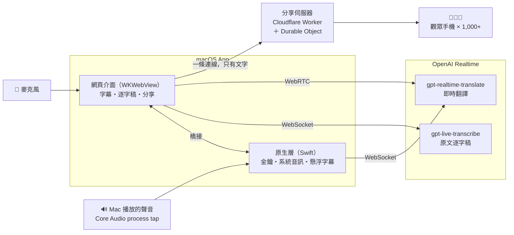
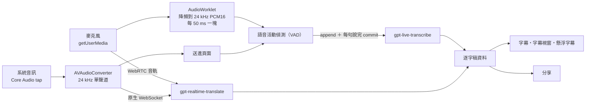
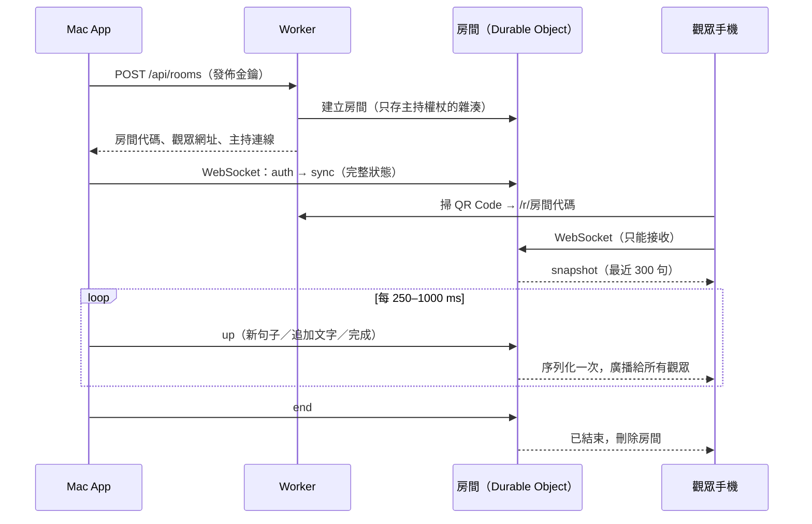

<p align="center">
  
</p>

<h1 align="center">Keynote Live Translator</h1>

<p align="center">
  <strong>演講、會議、影片的即時字幕與翻譯，還能讓全場觀眾用自己的手機同步看。</strong><br />
  以 OpenAI <code>gpt-live-transcribe</code> 與 <code>gpt-realtime-translate</code> 打造的 macOS 原生 App。
</p>

<p align="center">
  <a href="https://github.com/polarbear0827/GPT-Realtime-Translate/releases/latest"></a>
  <a href="https://github.com/polarbear0827/GPT-Realtime-Translate/actions/workflows/ci.yml"></a>
  
  
</p>

<p align="center">
  
</p>

---

## 目錄

- [為什麼用它](#為什麼用它)
- [功能導覽](#功能導覽)
- [快速開始](#快速開始)
- [分享給觀眾](#分享給觀眾)
- [技術架構](#技術架構)
- [效能與容量](#效能與容量)
- [安全與隱私](#安全與隱私)
- [品質保證](#品質保證)
- [開發](#開發)
- [疑難排解](#疑難排解)

## 為什麼用它

| | |
|---|---|
| 🎯 **為演講現場設計** | 大字幕、雙語對照、投影模式、第二螢幕字幕視窗、綠幕去背，開場前就能測好收音。 |
| 📱 **全場觀眾用手機看** | 掃 QR Code 就能看即時翻譯，不用裝 App。實測 1,000 位同時觀看，95% 的字幕在 0.35 秒內送達。 |
| 💸 **觀眾再多也不多花錢** | 翻譯只在講者的 Mac 上跑一次，分享出去的只是文字；分享伺服器用 Cloudflare 免費方案就夠。 |
| 🎧 **不用喇叭也能翻譯影片** | 直接擷取 Mac 正在播放的聲音（YouTube、線上會議），戴耳機也行，翻譯浮在全螢幕影片上。 |
| 🔐 **金鑰留在你的電腦** | OpenAI 金鑰只存在本機（可選擇存進 macOS 鑰匙圈），網頁端永遠拿不到；分享伺服器也是你自己的。 |
| 🧠 **兩個專用模型分工** | `gpt-live-transcribe` 負責準確的原文逐字稿（支援關鍵字與情境），`gpt-realtime-translate` 負責翻譯。 |
| 🛟 **長時間不中斷** | 斷線自動重連、55 分鐘前自動換新連線、停止時把最後一句說完，自動備份逐字稿。 |
| 📝 **會後直接有字幕檔** | 匯出 SRT（原文／翻譯／雙語）、Markdown、純文字、JSON，SRT 依字幕規範自動切句。 |
| 🪶 **輕巧原生** | Swift + WKWebView 的 universal App，約 4 MB，沒有 Electron，沒有背景服務。 |

## 功能導覽

### 雙語即時字幕

原文與翻譯上下對照，最新一句最醒目，舊的字慢慢淡出。可切換「雙語字幕／只顯示翻譯／只顯示原文」，支援 13 種原文語言與 13 種翻譯語言，中文一律以 OpenCC 轉成台灣繁體用語。

<p align="center"></p>

### 投影模式與字幕視窗

按 <kbd>F</kbd> 進入全螢幕投影模式，或開啟「字幕視窗（第二螢幕）」把字幕送到投影機、自己留著控制台。支援淺色／深色／純黑／綠幕（去背用）背景，字級與上下比例都能即時調整。

<p align="center"></p>

### 分享給觀眾

開始分享後，全場觀眾掃 QR Code 就能在自己的手機上看即時翻譯。你看得到線上人數，可以暫停分享（暫停時說的話永遠不會送出）、推送公告，結束後連結自動失效。

<p align="center"></p>

一鍵投影全螢幕 QR Code（<kbd>Q</kbd>），開著字幕視窗時也會同步出現在投影機上：

<p align="center"></p>

觀眾手機上的畫面：大字、最新一句高亮、可選擇顯示原文、深淺色與字級可調、螢幕保持不休眠，斷線自動接回並補齊漏掉的內容：

<p align="center"></p>

### 翻譯電腦正在播放的聲音（懸浮字幕）

音源選「電腦播放的聲音」，App 會用 Core Audio 直接擷取 Mac 的音訊（不需要外放），翻譯顯示在永遠置頂的毛玻璃懸浮視窗，連全螢幕影片上都看得到。視窗可任意拉大縮小（字跟著變大）、調整透明度、鎖定讓滑鼠穿透。

<p align="center"></p>

### 逐字稿與匯出

- 逐字稿面板即時記錄原文與翻譯，翻譯延遲可補償，時間軸跨多次開始／停止延續。
- 匯出 **SRT 雙語／翻譯／原文**、**Markdown**、**純文字**、**JSON**。SRT 每段最多 7 秒、兩行，中日韓文避免標點落在行首，可整體位移時間。
- 自動備份到本機，App 意外關閉後可以還原。

## 快速開始

1. 到 [Releases](https://github.com/polarbear0827/GPT-Realtime-Translate/releases/latest) 下載 `KeynoteLiveTranslator-<版本>.pkg` 並安裝（macOS 12.3 以上；擷取電腦聲音需要 macOS 14.2 以上）。
2. 開啟 App，輸入 OpenAI API key。金鑰會立刻驗證，並檢查兩個模型的使用權限；勾選「記住金鑰」才會存進 macOS 鑰匙圈。
3. 選擇模式與語言，到「設定 > 收音 > 測試麥克風」確認音量。可加上講者姓名、產品名稱等**關鍵字**與一句**情境說明**，提高專有名詞的準確度。
4. 按「開始」（或空白鍵）。

> **macOS 擋下 App？** 若發布版本尚未經過 Apple 公證：Finder →「應用程式」→ 對 Keynote Live Translator 按右鍵 →「打開」。

### 快捷鍵

| 按鍵 | 功能 | 按鍵 | 功能 |
|---|---|---|---|
| <kbd>Space</kbd> | 開始／停止 | <kbd>T</kbd> | 逐字稿面板 |
| <kbd>P</kbd> | 暫停／恢復字幕顯示 | <kbd>Q</kbd> | 投影分享用的 QR Code |
| <kbd>M</kbd> | 手動分段 | <kbd>+</kbd> / <kbd>−</kbd> | 放大／縮小字幕 |
| <kbd>F</kbd> | 投影模式 | <kbd>Esc</kbd> | 關閉面板、離開投影模式 |
| <kbd>⌘</kbd><kbd>⇧</kbd><kbd>O</kbd> | 懸浮字幕 | <kbd>⌘</kbd><kbd>⇧</kbd><kbd>L</kbd> | 鎖定懸浮字幕 |

## 分享給觀眾

### 一次性設定（約 5 分鐘）

分享需要一台你自己的分享伺服器（Cloudflare Worker，免費方案即可）。只要做一次：

1. 註冊免費的 [Cloudflare 帳號](https://dash.cloudflare.com/sign-up)。
2. 在這個專案資料夾執行：

   ```bash
   npm run relay:deploy
   ```

   第一次會開啟瀏覽器請你登入 Cloudflare 並授權；Cloudflare 可能會請你替 `workers.dev` 取一個名稱。
3. 部署完成後 App 會自動跳出「**連接分享伺服器？**」，按「**連接**」就完成，不用複製任何東西。

> 分享伺服器的網址印在每個 QR Code 上，所以需要一把「發佈金鑰」，確保只有你的 App 能開分享房間。這把金鑰由部署程式自動產生（存在 `relay/.publish-key`，不會上傳到 Git），並透過 `keynote-live-translator://` 連結直接交給 App、存進鑰匙圈；App 一定會先問你才連接。重灌或換電腦後執行 `npm run relay:connect` 即可重新連接。

### 活動當天

1. 「**分享 → 開始分享**」。可以先填活動名稱（顯示在觀眾手機上），決定要不要讓觀眾看原文。開場前就能開始，手機會顯示「等待講者開始」。
2. 「**投影 QR Code**」（<kbd>Q</kbd>）讓大家掃描，或在字幕畫面角落放一個小 QR Code。
3. 不想外流的段落按「**暫停分享**」；「**公告**」可以推一行字給所有人（例如中場休息）。
4. 結束時按「**結束分享**」：手機顯示「已結束」，連結失效。關閉 App 不會結束分享，12 小時內重新開啟可以接著分享，觀眾不用重掃。

## 技術架構



### 兩種宿主，同一套介面

| 宿主 | 介面來源 | API key 與 OpenAI 呼叫 | 本機連接埠 |
|---|---|---|---|
| macOS App | Swift 靜態伺服器（`127.0.0.1`，只提供靜態檔） | 原生 Swift，透過 `WKScriptMessageHandlerWithReply` | 只有靜態檔，檢查 Host |
| 瀏覽器（`npm start`） | Node 開發伺服器 | Node，需要每次啟動產生的權杖 | 檢查 Host／Origin／權杖 |

兩個後端都依照 [`public/realtime-config.json`](public/realtime-config.json)（模型、語言、限制）實作同一套規則，`tests/contract.test.mjs` 會編譯 Swift 版本，確認兩邊產生完全相同的 OpenAI 請求與錯誤訊息。

### 語音管線



- **原文**：`gpt-live-transcribe` 走 Realtime transcription session（WebSocket），沒有伺服器端 VAD，所以由前端的 VAD 在每句結束時 `commit`；太長的句子會在 15 秒後找停頓切開。支援 `languages`、`delay`（最即時～最準確五段）、`keywords`、`prompt`。
- **翻譯**：`gpt-realtime-translate` 自動偵測說話語言、輸出指定語言的文字（也能播放翻譯語音）。麥克風走 WebRTC（短效 client secret）；系統音訊已經在 App 裡，改走 App 自己的 WebSocket，避開 UDP 被擋的網路。
- **韌性**：每條連線各自指數退避重連；Realtime session 有 60 分鐘上限，所以 55 分鐘時先接好新連線、再無縫切換音訊；按停止時用 `session.close` 等最後一句翻完。

### 字幕與逐字稿

- 原文與翻譯各自是一條有時間的軌道，匯出 SRT 時依時間重疊對齊，翻譯延遲不會讓原文錯位。
- 串流文字在「確認的句尾」才切句（`3.` 可能還是 `3.14`），太長時改在逗號切。
- 簡轉繁在顯示與匯出時整段轉換（OpenCC `cn → twp`），不在每個片段上轉，跨片段的詞（头＋发 → 頭髮）也正確。
- 畫面更新以每個動畫幀合併一次；懸浮字幕用計時器驅動，被全螢幕影片蓋住時照樣更新。

### macOS 原生層

- Swift AppKit + WKWebView，`swiftc` 直接編出 arm64 + x86_64 universal binary，`pkgbuild` 打包，約 4 MB。
- 頁面由 `Network.framework` 寫的本機靜態伺服器提供（`127.0.0.1`，拒絕其他 Host 以防 DNS rebinding），OpenAI 金鑰只存在原生端。
- 系統音訊：`CATapDescription` ＋ `AudioHardwareCreateProcessTap` 建立 process tap 與 aggregate device，切換輸出裝置時自動重建。
- 懸浮字幕：不搶焦點的 `NSPanel`（`.statusBar` 層級、所有桌面空間、全螢幕輔助），字級由視窗高度反推，整句排版、最舊的句子先捨棄。

### 分享伺服器（`relay/`）



- **一個房間一個 Durable Object**，使用 WebSocket Hibernation API：沒有訊息時可以休眠不計費，觀眾的 ping 由 Cloudflare 自動回應，不會喚醒房間。
- **增量協定**：每句字幕是一個項目，送「新增／追加文字／標記完成／刪除」四種操作；大多數更新只是追加幾個字。房間只在記憶體保留最近 300 句，被回收後由 App 重新同步。
- **依人數調整更新頻率**：400 人以內每秒 4 次，1,500 人以內每秒 2 次，再多每秒 1 次（見[效能與容量](#效能與容量)）。
- **觀眾頁**是純靜態網頁（無框架、無追蹤），支援 Wake Lock、斷線抖動重連、深淺色與字級設定。
- **QR Code** 由內建的編碼器產生（不依賴第三方套件），測試裡用 Apple Vision 實際解碼驗證。

## 效能與容量

在 Cloudflare 上以模擬觀眾實測（全部從同一台 Mac 連線，基準往返約 0.2 秒）：

| 同時觀看 | 更新頻率 | 送達率 | 95% 字幕延遲 | 99% 字幕延遲 |
|---:|---:|---:|---:|---:|
| 200 | 每秒 4 次 | 100% | 0.49 秒 | 0.74 秒 |
| **1,000** | **每秒 2 次（自動）** | **100%** | **0.35 秒** | **0.37 秒** |
| 1,500 | 每秒 1 次 | 100% | 0.85 秒 | 1.24 秒 |
| 2,000 | 每秒 1 次 | 100% | 1.32 秒 | 2.37 秒 |

本機（`wrangler dev`）測試 2,000 位觀眾：100% 送達，95% 在 65 毫秒內。自己測：

```bash
npm run relay:load-test -- --url https://klt-relay.<你的名稱>.workers.dev --viewers 1000 --seconds 30
```

**費用**：OpenAI 只依講者端的音訊計費，與觀看人數無關。Cloudflare 免費方案每天 100,000 次請求，一場一小時、1,000 人的演講只用掉一小部分。

## 安全與隱私

- **OpenAI 金鑰**：執行時由使用者輸入，不寫進 App；預設只在記憶體，勾選後才存進 macOS 鑰匙圈；只用來換取短效的 Realtime client secret，網頁端拿不到長期金鑰。
- **本機服務**：開發伺服器檢查 `Host`（防 DNS rebinding）、`Origin`、`Content-Type` 與每次啟動的權杖；macOS App 完全不對外提供 API，只接受自己頁面的訊息。
- **內容安全政策（CSP）**：頁面只能連到 OpenAI 與你設定的那台分享伺服器。
- **分享**：
  - 只有持有發佈金鑰的 App 能開房間，每個房間另有主持權杖（伺服器只存雜湊）。
  - 觀眾連線只能接收，送任何東西都會被忽略。
  - 開始分享前的字幕、暫停期間說的話都不會送出；只有你允許時才會送出原文。
  - 字幕只存在房間的記憶體，結束分享即刪除房間；主持端離線 12 小時後房間自動刪除。
  - 自動連接用的 `keynote-live-translator://` 連結只接受 https 的伺服器與正確格式的金鑰，且一定會先詢問使用者。

## 品質保證

每次推送都會在 GitHub Actions 上自動執行（Linux 與 macOS）：

| 測試 | 內容 |
|---|---|
| **Node 單元與整合測試（90 項）** | 文字處理、繁簡轉換、逐字稿與 SRT、設定、開發伺服器安全、Session 控制器（重連、換線、取消）、分享發佈器、房間邏輯、QR 編碼器 |
| **Swift ↔ Node 合約測試** | 編譯原生後端，確認兩邊對同一組輸入產生完全相同的結果 |
| **macOS 真實環境測試（50 項）** | 在離屏 WKWebView 跑真正的介面與原生橋接：系統音訊、懸浮字幕排版、分享設定與 CSP、自動連接連結、Apple Vision 解碼 QR Code |
| **分享伺服器端對端測試（8 項）＋壓力測試** | 在 `wrangler dev`（workerd）跑真正的 Worker：權限、廣播、觀眾不能發送、主持端重連與重新同步；CI 另跑 300 位模擬觀眾 |

## 開發

需求：Node.js 22 以上（見 `.nvmrc`）；macOS App 需要 Xcode 命令列工具。

```bash
npm start                 # 開發伺服器 http://127.0.0.1:8787（加上 ?debug 可在主控台存取內部狀態）
npm run check             # 語法檢查
npm test                  # Node 測試（含 Swift ↔ Node 合約測試）
npm run test:macos        # 離屏 WKWebView 真實環境測試
npm run build:pkg         # universal App ＋ 安裝檔，輸出到 build/v<版本>/

npm run relay:dev         # 本機分享伺服器 http://127.0.0.1:8788（需要 relay/.dev.vars：PUBLISH_KEY=kltp_…）
npm run relay:test        # 分享伺服器端對端測試
npm run relay:load-test -- --viewers 2000
zsh scripts/make-icons.sh # 從 assets/logo.png 重新產生 App 圖示與網頁圖示
```

開發伺服器可用 `KLT_RELAY_URL`、`KLT_RELAY_KEY` 環境變數指定分享伺服器。

### 專案結構

```text
public/             介面（ES modules，無框架、無建置步驟）
  js/session.js       連線、重連、換線、VAD commit
  js/transcript.js    逐字稿資料（時間軸、切句）
  js/share*.js        分享發佈器與分享面板
  js/qr.js            QR Code 編碼器
server/             開發伺服器與共用驗證規則
src/macos/          原生 App：靜態伺服器、橋接、鑰匙圈、系統音訊、懸浮字幕
relay/              分享伺服器：Cloudflare Worker、Durable Object、觀眾頁、測試與壓力測試
scripts/            建置、打包、部署分享伺服器、產生圖示
tests/              Node 測試與 macOS 真實環境測試
```

### 發布流程

1. 更新 `VERSION`（版本號唯一的來源，App 與介面都從這裡讀）與 `package.json`（測試會檢查兩者一致）。
2. 在 `CHANGELOG.md` 加一段，並新增 `RELEASE_NOTES_v<版本>.md`。
3. Commit、打 `v<版本>` 標籤並推送。GitHub Actions 會確認標籤與 `VERSION` 相同、跑完測試，再發布 macOS 安裝檔。

可選的簽章與公證：在 repository secrets 設定 `MACOS_CERTIFICATES_P12`、`MACOS_CERTIFICATES_PASSWORD`、`MACOS_CODESIGN_IDENTITY`、`MACOS_INSTALLER_IDENTITY`，以及公證用的 `NOTARY_KEY_BASE64`、`NOTARY_KEY_ID`、`NOTARY_ISSUER`。

## 疑難排解

| 狀況 | 解法 |
|---|---|
| 沒有收到麥克風聲音 | 「系統設定 > 隱私權與安全性 > 麥克風」允許 Keynote Live Translator，然後重新開啟 App。 |
| 選「電腦播放的聲音」卻沒有字幕 | 確認正在播放聲音，並到「系統設定 > 隱私權與安全性 > 螢幕與系統錄音」的「僅限系統錄音」允許本 App（變更後需重新開啟）。 |
| 原文與翻譯語言相同時沒有翻譯 | 翻譯模型不會輸出同語言內容；只需要字幕時請改用「只顯示原文」。 |
| 觀眾手機連不上 | 確認場地網路能連到 `*.workers.dev`；行動網路通常最穩。場地 Wi‑Fi 的用戶端隔離不影響分享（流量經過雲端）。 |
| 分享字幕延遲偏高 | 講者的 Mac 若開著 VPN，房間可能建在國外的節點；活動時關閉 VPN 可再快約 0.2 秒。 |
| 想重新連接分享伺服器 | 執行 `npm run relay:connect`，在 App 跳出的視窗按「連接」。 |

---

版本紀錄見 [CHANGELOG.md](CHANGELOG.md)。翻譯由 AI 即時產生，重要場合請搭配人工確認。
